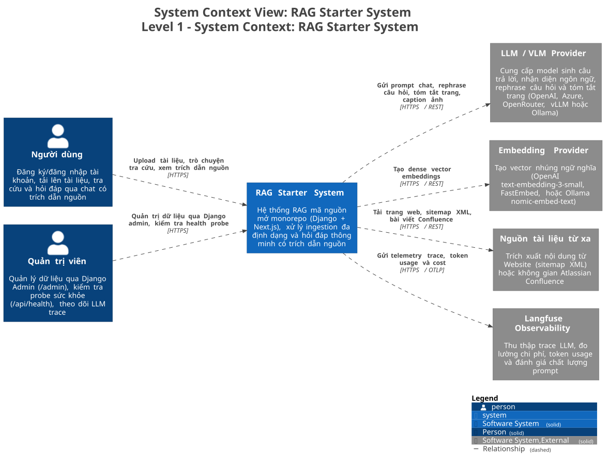
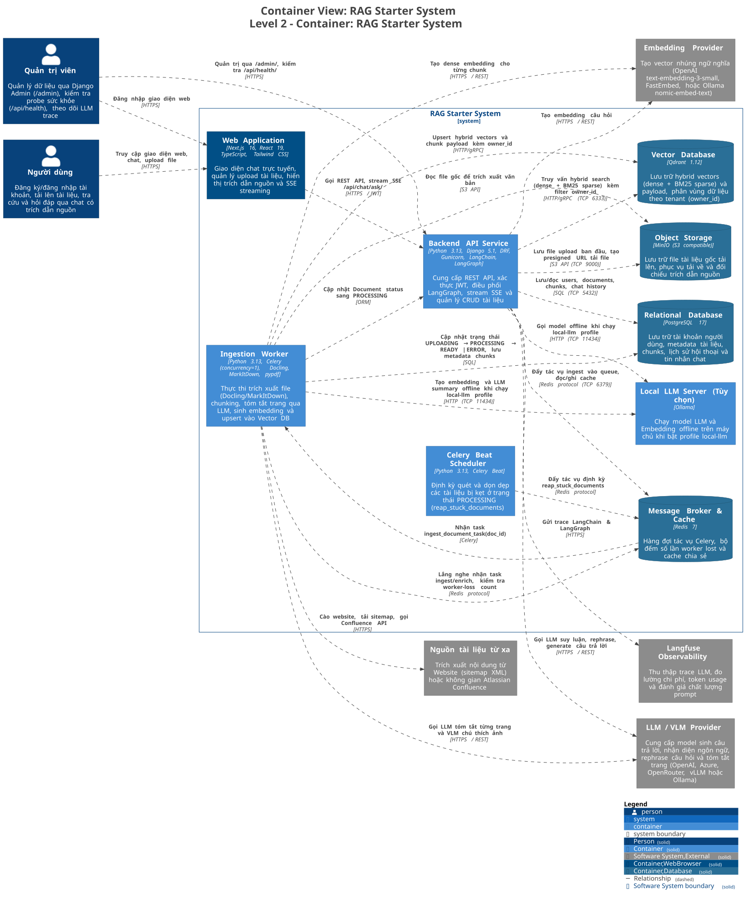
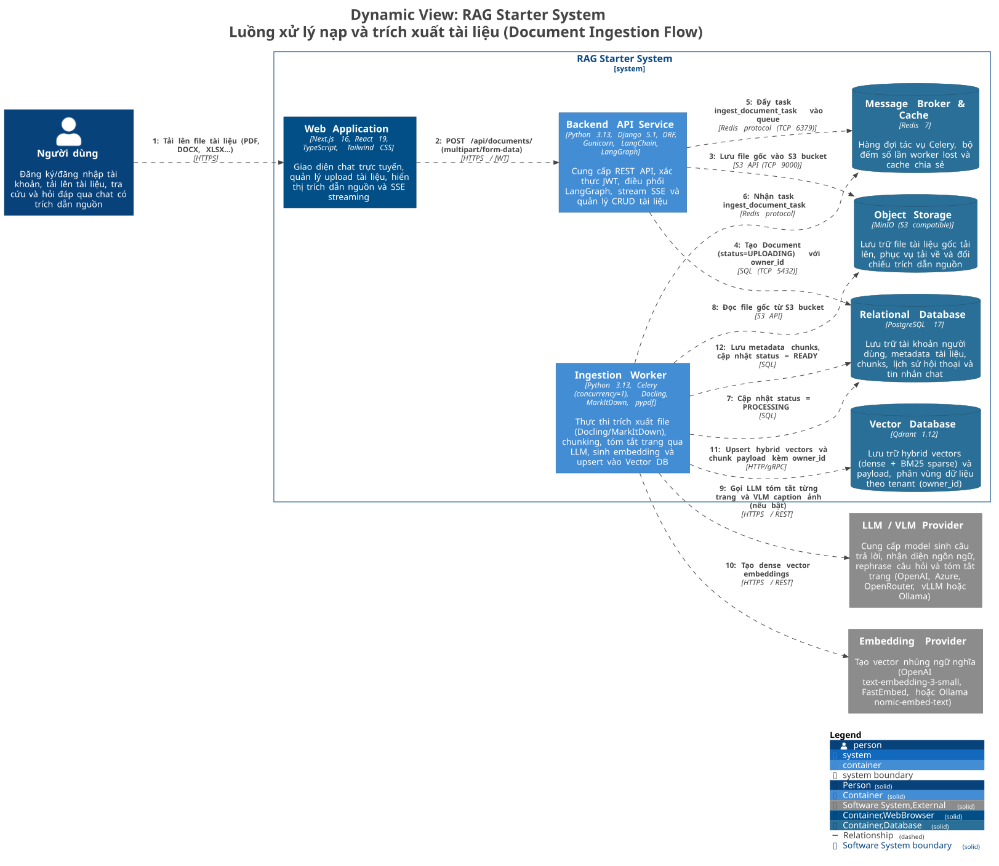
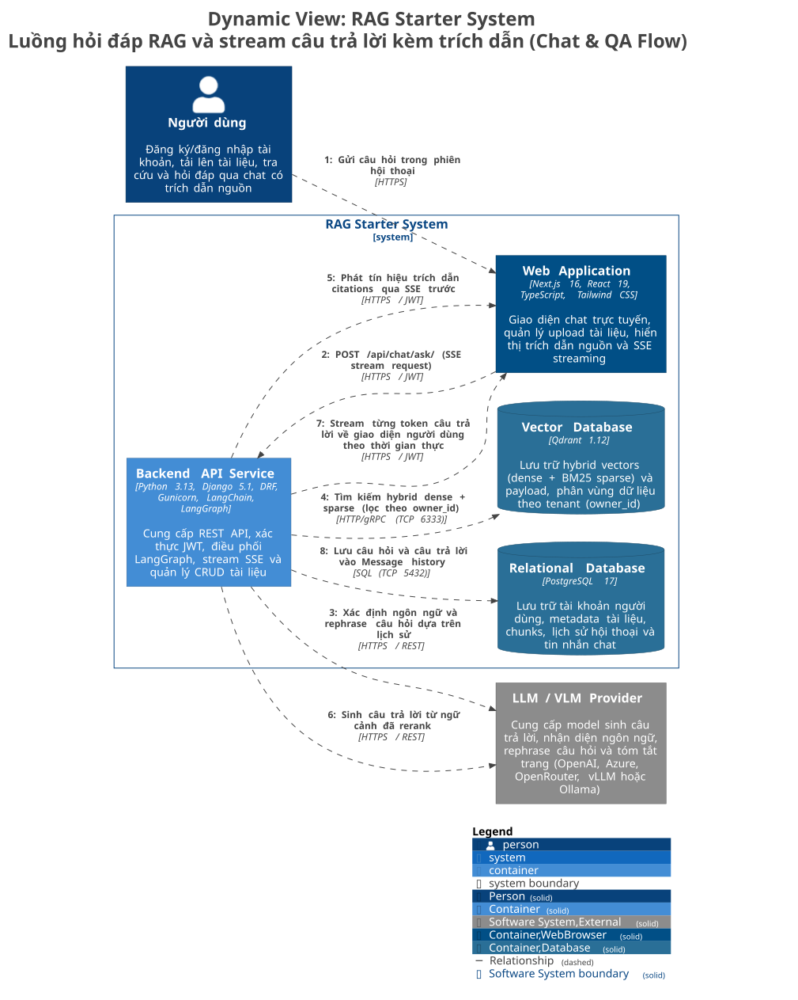
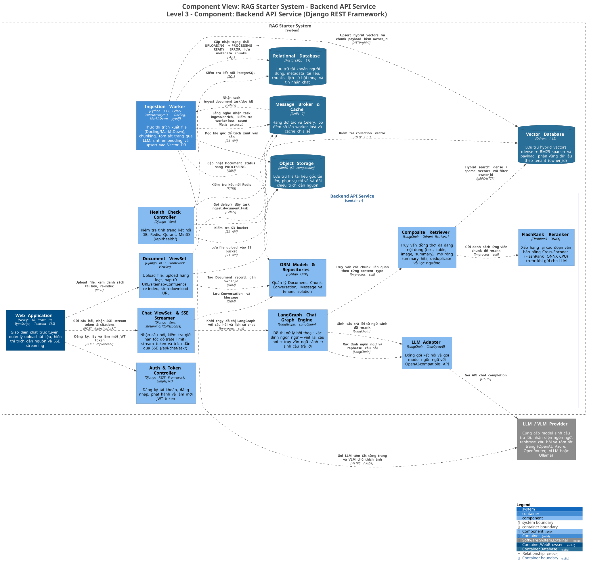
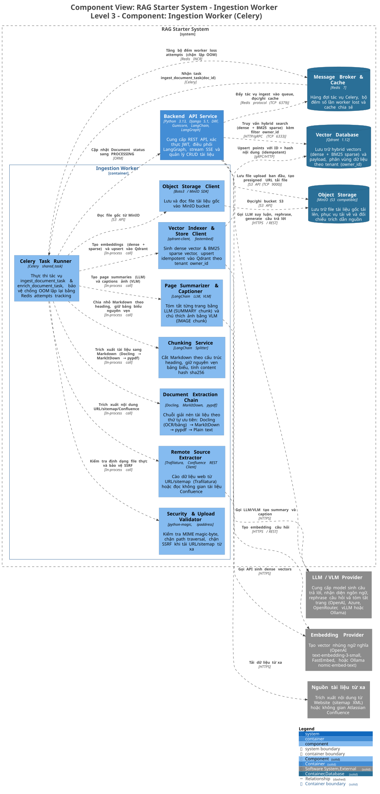

# Mô hình C4 hệ thống RAG Starter (KashifAgha/rag-starter)

Tài liệu mô tả kiến trúc của repo [KashifAgha/rag-starter](https://github.com/KashifAgha/rag-starter). Đây là hệ thống RAG mã nguồn mở được tái cấu trúc từ dự án `stackitcloud/rag-template`: gom cụm 5 microservice FastAPI và frontend Vue thành một backend Django 5 kết hợp frontend Next.js 16.

Hệ thống hỗ trợ nạp tài liệu đa định dạng (PDF, DOCX, XLSX, web, sitemap, Confluence), trích xuất cấu trúc văn bản, chia chunk bảo toàn bảng biểu, sinh vector hybrid (dense kết hợp BM25 sparse), lưu trữ vào Qdrant và trả lời câu hỏi kèm trích dẫn nguồn qua Server-Sent Events (SSE).

> Toàn bộ sơ đồ trong tài liệu được sinh từ [`architecture/workspace.dsl`](architecture/workspace.dsl) (Structurizr DSL). Chạy `./docs/KashifAgha/architecture/render.sh` (yêu cầu Docker) để cập nhật lại ảnh SVG và PNG trong thư mục `architecture/diagrams/`.

---

## Level 1 – System Context

Sơ đồ ngữ cảnh thể hiện người dùng tương tác và các hệ thống bên ngoài kết nối với RAG Starter System.



<sub>Ảnh PNG: [`L1-SystemContext.png`](architecture/diagrams/L1-SystemContext.png) · Mã PlantUML: [`L1-SystemContext.puml`](architecture/diagrams/L1-SystemContext.puml)</sub>

| Thực thể | Phân loại | Vai trò và giao thức kết nối |
|---|---|---|
| **Người dùng** | Người dùng | Đăng ký, đăng nhập tài khoản, tải lên tài liệu, tra cứu kiến thức qua chat và xem trích dẫn nguồn qua giao diện web (HTTPS). |
| **Quản trị viên** | Người dùng | Quản lý người dùng, tài liệu và chunk qua Django Admin (`/admin`), kiểm tra probe trạng thái (`/api/health`) và giám sát hệ thống (HTTPS). |
| **RAG Starter System** | Hệ thống phần mềm | Hệ thống RAG monorepo đảm nhận toàn bộ việc nạp tài liệu, lập chỉ mục vector và xử lý luồng hỏi đáp. |
| **LLM / VLM Provider** | Hệ thống bên ngoài | Cung cấp model ngôn ngữ và thị giác (OpenAI GPT-4o-mini, Azure OpenAI, OpenRouter, vLLM hoặc Ollama local) để rephrase câu hỏi, tóm tắt trang, sinh caption ảnh và trả lời ngữ cảnh (HTTPS/REST). |
| **Embedding Provider** | Hệ thống bên ngoài | Cung cấp model nhúng vector dense (OpenAI text-embedding-3-small, FastEmbed hoặc Ollama nomic-embed-text) chuyển văn bản thành vector (HTTPS/REST). |
| **Nguồn tài liệu từ xa** | Hệ thống bên ngoài | Website ngoài, sitemap XML hoặc không gian Atlassian Confluence để hệ thống cào dữ liệu tự động (HTTPS). |
| **Langfuse Observability** | Hệ thống bên ngoài | Nền tảng quan sát LLM tùy chọn, thu thập trace thực thi LangGraph, đo lường số token tiêu thụ và chi phí (HTTPS/OTLP). |

---

## Level 2 – Container

Hệ thống triển khai qua Docker Compose gồm các container chạy backend, worker, giao diện và các kho dữ liệu.



<sub>Ảnh PNG: [`L2-Container.png`](architecture/diagrams/L2-Container.png) · Mã PlantUML: [`L2-Container.puml`](architecture/diagrams/L2-Container.puml)</sub>

| Container | Công nghệ sử dụng | Trách nhiệm và tài nguyên cấu hình |
|---|---|---|
| **Web Application** | Next.js 16, React 19, TypeScript, Tailwind CSS | Giao diện người dùng cho phiên chat, quản lý danh sách tài liệu, hiển thị trích dẫn thời gian thực. Giới hạn bộ nhớ 1GB, cổng 3000. |
| **Backend API Service** | Python 3.13, Django 5.1, DRF, Gunicorn, LangGraph | Cung cấp REST API, xác thực JWT, điều phối đồ thị hội thoại LangGraph, stream kết quả SSE và lưu trữ nghiệp vụ. Giới hạn bộ nhớ 2GB, cổng 8000. |
| **Ingestion Worker** | Python 3.13, Celery, Docling, MarkItDown, pypdf | Thực thi tác vụ nạp nền: trích xuất văn bản, cắt chunk, tóm tắt trang, sinh embedding và upsert vào Qdrant. Đặt `concurrency=1` và bộ nhớ 2GB để tránh OOM khi chạy Docling. |
| **Celery Beat Scheduler** | Python 3.13, Celery Beat | Bộ lập lịch định kỳ thực hiện task `reap_stuck_documents` nhằm phát hiện và đổi trạng thái các tài liệu bị kẹt ở `PROCESSING`. Giới hạn bộ nhớ 256MB. |
| **Relational Database** | PostgreSQL 17 Alpine | Lưu trữ bảng người dùng, metadata tài liệu, chunks, phiên hội thoại và tin nhắn. Giới hạn bộ nhớ 768MB, cổng 5432 (host port 5433). |
| **Message Broker & Cache** | Redis 7 Alpine | Làm hàng đợi cho Celery (`celery` queue), lưu bộ đếm số lần worker thất thoát (`rag:ingest_attempts:{id}`) và cache. Giới hạn bộ nhớ 768MB (maxmemory 512MB LRU). |
| **Object Storage** | MinIO RELEASE.2025 | Lưu trữ file nhị phân gốc được tải lên để phục vụ tải về và xác minh trích dẫn. Giới hạn bộ nhớ 512MB, cổng S3 9000, console 9001. |
| **Vector Database** | Qdrant v1.12.6 | Lưu trữ vector nhúng hybrid (dense kết hợp BM25 sparse) và metadata chunk. Hỗ trợ lọc trực tiếp theo `owner_id`. Giới hạn bộ nhớ 1GB, cổng 6333/6334. |
| **Local LLM Server (Tùy chọn)** | Ollama | Cung cấp LLM và model embedding chạy offline trên máy chủ (chạy khi bật profile `local-llm`). Cổng 11434. |

---

## Luồng xử lý chính

### 1. Luồng nạp tài liệu (Document Ingestion Flow)

Tác vụ nạp tài liệu chạy không đồng bộ qua Celery worker nhằm tránh nghẽn luồng xử lý HTTP request.



<sub>Ảnh PNG: [`L2-Flow-Ingestion.png`](architecture/diagrams/L2-Flow-Ingestion.png) · Mã PlantUML: [`L2-Flow-Ingestion.puml`](architecture/diagrams/L2-Flow-Ingestion.puml)</sub>

Các bước thực hiện khi nạp một tài liệu:

1. Người dùng tải file lên qua giao diện Web (`multipart/form-data`).
2. Giao diện gửi request kèm header JWT tới Backend API `POST /api/documents/`.
3. Backend API kiểm tra file ban đầu, lưu file gốc vào bucket MinIO qua S3 API.
4. Backend API ghi bản ghi vào PostgreSQL với trạng thái `UPLOADING` và gắn `owner_id`.
5. Backend API đẩy tác vụ `rag.ingest_document(document_id)` vào hàng đợi Redis qua Celery.
6. Ingestion Worker nhận tác vụ từ Redis, cập nhật số lần thử vào cache Redis (giới hạn tối đa 3 lần thử khi tiến trình worker bị tắt ngang do OOM).
7. Worker cập nhật trạng thái tài liệu trong PostgreSQL sang `PROCESSING`.
8. Worker đọc file từ MinIO, đưa qua chuỗi trích xuất: ưu tiên Docling (xử lý bố cục, OCR, cấu trúc bảng), nếu thiếu thư viện thì chuyển sang MarkItDown, pypdf hoặc plain text.
9. Worker chia nhỏ Markdown thành các chunk: cắt theo heading cấu trúc, giữ nguyên vẹn khối bảng biểu, tính mã băm nội dung SHA-256 để đảm bảo tính idempotent.
10. Nếu bật cấu hình tóm tắt (`SUMMARIZER_ENABLED=True`), worker gọi LLM tóm tắt từng trang thành chunk loại `SUMMARY` liên kết tới các chunk con; gọi VLM chú thích ảnh nếu có.
11. Worker tính toán vector nhúng dense và vector sparse BM25 cho từng chunk rồi upsert vào collection Qdrant, đính kèm metadata và `owner_id`.
12. Worker lưu metadata các chunk vào PostgreSQL và đổi trạng thái tài liệu sang `READY`. Nếu gặp lỗi không phục hồi được, trạng thái chuyển sang `ERROR` kèm thông báo chi tiết.

### 2. Luồng hỏi đáp và suy luận (Chat & QA Flow)

Đồ thị hội thoại được điều phối bởi LangGraph theo kiến trúc 4 nút tuần tự:

```text
START ──► determine_language ──► rephrase ──► retrieve ──┬──► generate ──► END
                                                         └──► error_node ──► END
```



<sub>Ảnh PNG: [`L2-Flow-Chat.png`](architecture/diagrams/L2-Flow-Chat.png) · Mã PlantUML: [`L2-Flow-Chat.puml`](architecture/diagrams/L2-Flow-Chat.puml)</sub>

Chi tiết từng bước trong luồng hỏi đáp:

1. Người dùng gửi câu hỏi trên giao diện chat.
2. Web client gửi request `POST /api/chat/ask/` duy trì kết nối SSE.
3. Backend khởi tạo phiên LangGraph, kiểm tra rate limit (`THROTTLE_CHAT`).
4. **Nút determine_language**: Xác định ngôn ngữ của câu hỏi qua LLM (dùng `langdetect` làm phương án dự phòng) để câu trả lời cùng ngôn ngữ với câu hỏi.
5. **Nút rephrase**: Phân tích lịch sử hội thoại gần nhất, viết lại câu hỏi nối tiếp thành câu truy vấn độc lập hoàn chỉnh.
6. **Nút retrieve**:
   - Truy vấn đồng thời các bộ sưu tập nội dung (văn bản thường, bảng biểu, ảnh và bản tóm tắt trang).
   - Truy vấn hybrid trong Qdrant kết hợp vector dense và BM25 sparse, luôn áp bộ lọc bắt buộc `owner_id == request.user.id`.
   - Nếu tìm thấy chunk loại `SUMMARY`, hệ thống tự động mở rộng và lấy các chunk gốc cấu thành trang đó.
   - Hợp nhất kết quả, loại bỏ trùng lặp và giữ lại tối đa `RETRIEVER_TOTAL_K_DOCUMENTS` (mặc định 10).
   - Đưa danh sách ứng viên qua FlashRank Cross-Encoder để xếp hạng lại độ liên quan, cắt gọn còn `RERANKER_K_DOCUMENTS` (mặc định 5).
7. Backend phát danh sách trích dẫn (citations) về client qua event SSE trước khi sinh chữ.
8. **Nút generate**: Đưa ngữ cảnh đã trích xuất vào prompt hệ thống, yêu cầu LLM trả lời bám sát tài liệu và từ chối nếu ngữ cảnh không đủ thông tin.
9. Backend stream từng token sinh ra về giao diện người dùng theo thời gian thực.
10. Lưu câu hỏi và câu trả lời hoàn chỉnh vào bảng Message trong PostgreSQL.

---

## Level 3 – Component

### 3.1 Backend API Service (Django REST Framework)

Backend API tiếp nhận request từ giao diện, xác thực người dùng và điều phối đồ thị LangGraph.



<sub>Ảnh PNG: [`L3-BackendAPI.png`](architecture/diagrams/L3-BackendAPI.png) · Mã PlantUML: [`L3-BackendAPI.puml`](architecture/diagrams/L3-BackendAPI.puml)</sub>

| Thành phần | Vị trí mã nguồn | Trách nhiệm chính |
|---|---|---|
| **Auth & Token Controller** | `backend/api/urls.py`, SimpleJWT | Đăng ký tài khoản, đăng nhập, cấp phát và refresh cặp token JWT. |
| **Health Check Controller** | `backend/api/views.py` | Kiểm tra tình trạng kết nối DB, Redis, Qdrant và MinIO qua endpoint `/api/health/`. |
| **Document ViewSet** | `backend/rag/views.py` | Tiếp nhận upload file, upload hàng loạt, gọi trích xuất URL/sitemap/Confluence, re-index, tạo URL download từ MinIO và xóa tài liệu. |
| **Chat ViewSet & SSE Streamer** | `backend/rag/views.py` | Endpoint `/api/chat/ask/`, kiểm tra throttle rate limit, dựng `StreamingHttpResponse` phát token và citation về client. |
| **LangGraph Chat Graph Engine** | `backend/rag/graph.py` | Khởi tạo StateGraph của LangGraph, kết nối 4 nút xử lý và quản lý streaming generator. |
| **Composite Retriever** | `backend/rag/retrieval.py` | Điều phối tìm kiếm đa nội dung, xử lý logic mở rộng summary chunk và lọc ngưỡng độ tương đồng (`RETRIEVER_THRESHOLD`). |
| **FlashRank Reranker** | `backend/rag/rerank.py` | Đóng gói model FlashRank ONNX chạy trên CPU, khôi phục metadata bị mất trong quá trình rerank của LangChain. |
| **LLM Adapter** | `backend/rag/llm.py`, `conf.py` | Khởi tạo client gọi LLM tương thích chuẩn OpenAI, nạp cấu hình nhiệt độ, timeout và tích hợp Langfuse callback. |
| **ORM Models & Repositories** | `backend/rag/models.py` | Định nghĩa model `Document`, `Chunk`, `Conversation`, `Message`, đảm bảo cô lập dữ liệu theo `owner_id`. |

### 3.2 Ingestion Worker (Celery)

Container Worker dùng chung image và codebase với API nhưng khởi chạy bằng lệnh Celery worker chuyên biệt.



<sub>Ảnh PNG: [`L3-IngestionWorker.png`](architecture/diagrams/L3-IngestionWorker.png) · Mã PlantUML: [`L3-IngestionWorker.puml`](architecture/diagrams/L3-IngestionWorker.puml)</sub>

| Thành phần | Vị trí mã nguồn | Trách nhiệm chính |
|---|---|---|
| **Celery Task Runner** | `backend/rag/tasks.py` | Định nghĩa tác vụ `ingest_document_task` và `enrich_document_task`. Theo dõi số lần worker bị kill qua key Redis `rag:ingest_attempts:{id}` để không lặp vô hạn khi gặp file gây OOM. |
| **Security & Upload Validator** | `backend/rag/security.py` | Đọc magic byte kiểm tra định dạng file thực, chuẩn hóa tên file chống path traversal, giải mã IP chống SSRF khi tải URL và sitemap từ xa. |
| **Remote Source Extractor** | `backend/rag/extract.py` | Cào nội dung bài viết từ URL/sitemap qua Trafilatura, hoặc duyệt không gian tài liệu Confluence qua REST API. |
| **Document Extraction Chain** | `backend/rag/extract.py` | Chuỗi fallback trích xuất file theo thứ tự: Docling (giữ layout, bảng, OCR) → MarkItDown → pypdf → Plain text parser. |
| **Chunking Service** | `backend/rag/chunking.py` | Cắt nhỏ văn bản Markdown theo cấu trúc tiêu đề, bảo toàn nguyên vẹn bảng Markdown, tính content hash cho mỗi chunk. |
| **Page Summarizer & Captioner** | `backend/rag/enhance.py`, `image_captioner.py` | Tóm tắt từng trang thành `SUMMARY` chunk trỏ về các chunk con; gọi model thị giác VLM mô tả hình ảnh trích xuất. |
| **Vector Indexer & Store Client** | `backend/rag/vectordb.py`, `ingest.py` | Sinh dense embedding và BM25 sparse vector, kết nối QdrantClient thực hiện upsert point idempotent theo ID băm nội dung. |
| **Object Storage Client** | `backend/rag/storage.py`, MinIO SDK | Tải file gốc từ bucket MinIO về thư mục tạm trên worker để trích xuất và xóa file tạm sau khi hoàn tất. |

---

## Các quyết định kỹ thuật cốt lõi

1. **Gom microservice thành monorepo thực dụng**: Thay vì chia nhỏ thành 5 service giao tiếp qua HTTP nội bộ và OpenAPI client sinh tự động, dự án chuyển các bước xử lý thành lời gọi hàm Python trực tiếp. Trạng thái xử lý lưu trong bảng PostgreSQL thay vì key-value Redis tạm thời, giúp trạng thái sống sót sau khi khởi động lại hệ thống.
2. **Cô lập tenant ngay tại tầng vector database**: Mỗi truy vấn Qdrant bắt buộc đính kèm bộ lọc `owner_id`. Người dùng không thể truy vấn hoặc đọc nhầm chunk của tài khoản khác.
3. **Cơ chế hybrid search kết hợp tóm tắt mở rộng**: Kết hợp vector dense và BM25 sparse giúp giải quyết cả nhu cầu tìm kiếm ngữ nghĩa lẫn tìm kiếm chính xác từ khóa định danh, mã lỗi. Chunk tóm tắt trang (`SUMMARY`) giúp trả lời các câu hỏi bao quát trên toàn tài liệu.
4. **Phòng chống OOM do model nặng**: Celery worker chạy với tham số `--concurrency=1` và cấp phát cứng 2GB RAM. Thư viện Docling nạp mô hình deep learning nhận diện bố cục nặng, nên việc giới hạn xử lý tuần tự từng tài liệu ngăn ngừa tình trạng container bị kill bởi Linux OOM Killer. Bộ đếm số lần thất thoát trên Redis tự động đánh dấu `ERROR` sau 3 lần crash liên tiếp.
5. **Bảo mật nạp dữ liệu**: Toàn bộ file tải lên được kiểm tra magic byte tại tầng worker; đường dẫn URL từ xa được giải mã DNS nhằm chặn các dải IP nội bộ, loopback và metadata cloud (`169.254.169.254`).
