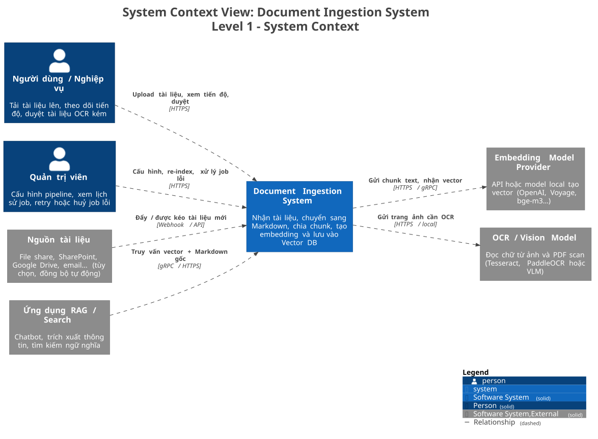
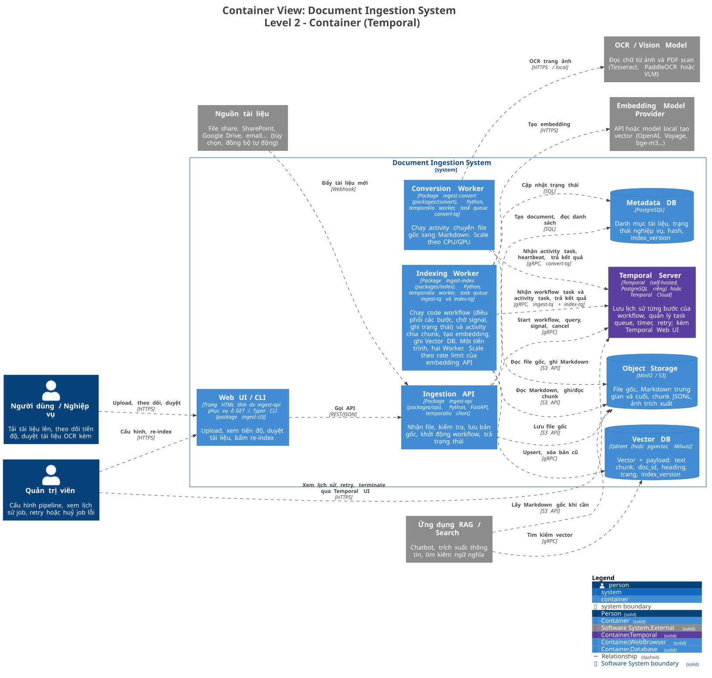
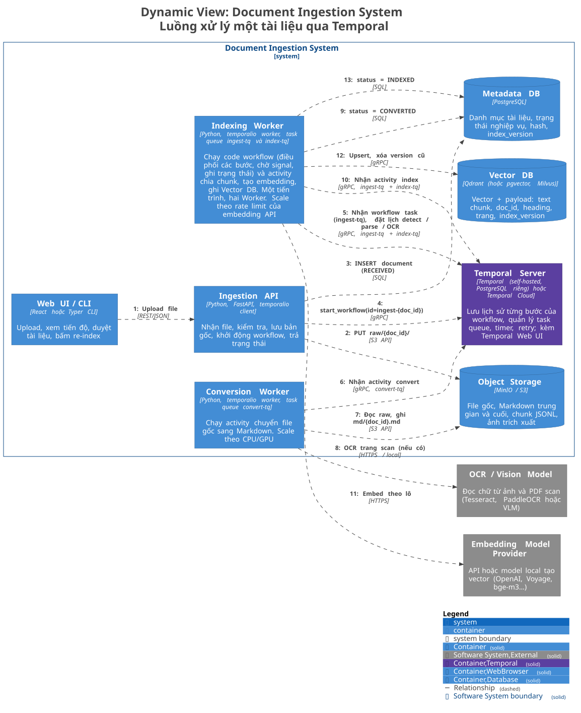
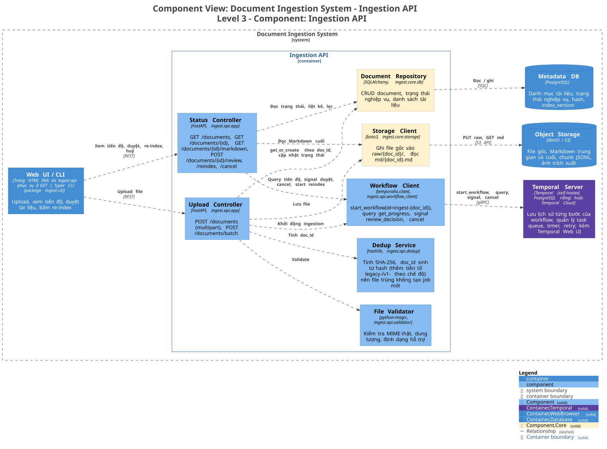
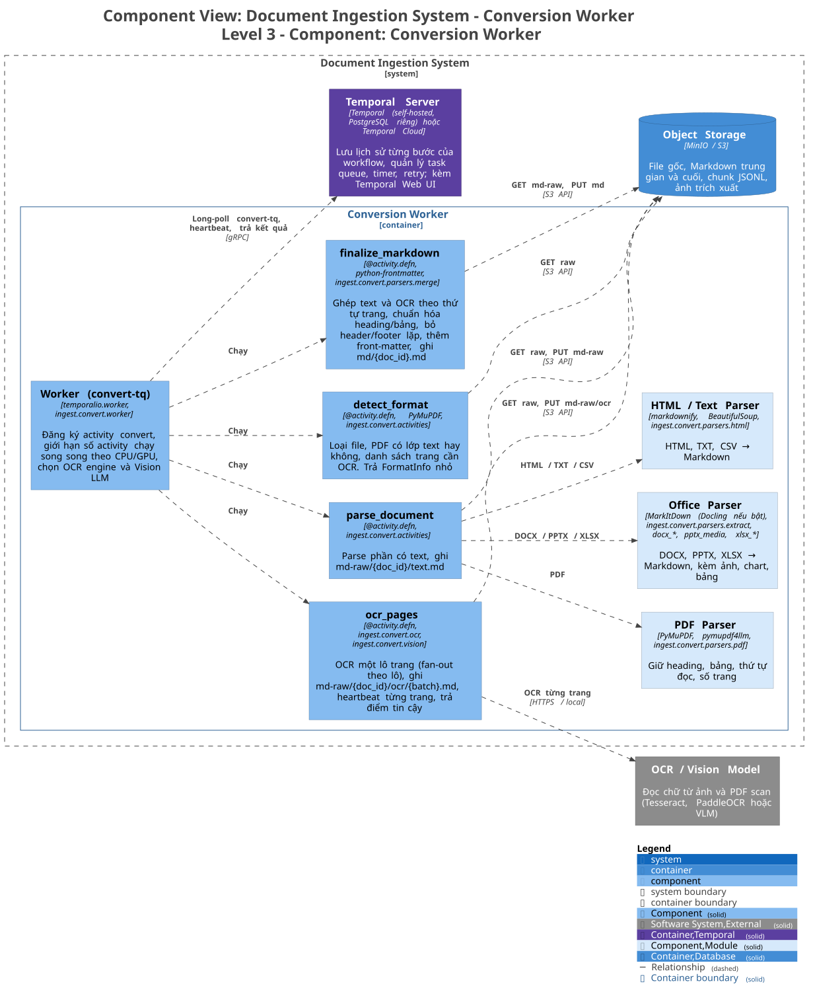
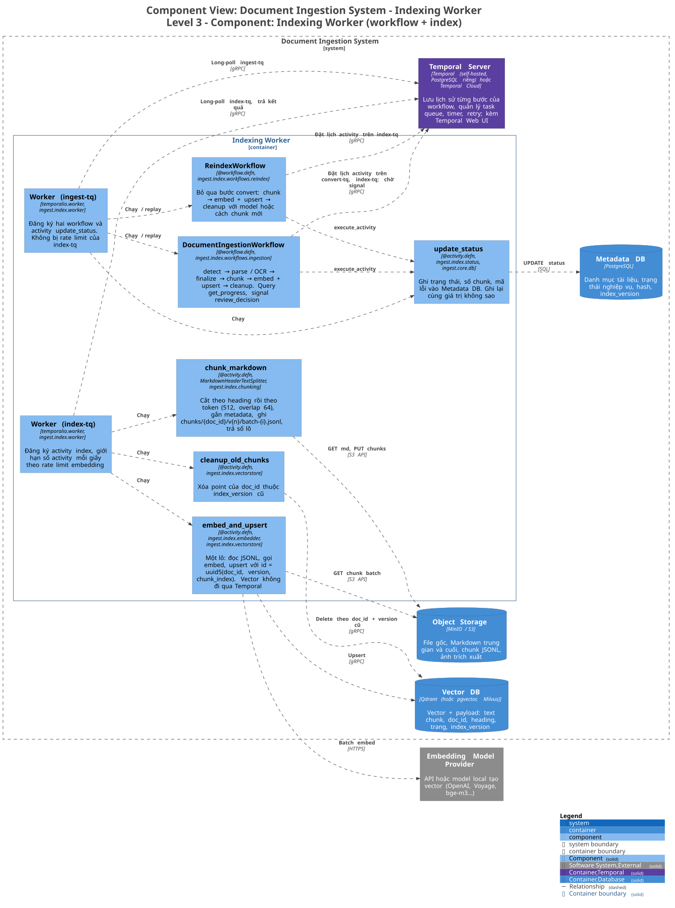

# Mô hình C4 của hệ thống xử lý tài liệu đầu vào

Hệ thống nhận file tài liệu (PDF, DOCX, PPTX, XLSX, HTML, ảnh scan…), chuyển sang Markdown, chia chunk, tạo embedding rồi lưu vào Vector DB để các ứng dụng RAG và tìm kiếm dùng lại. Temporal điều phối toàn bộ các bước. Khái niệm và luật viết workflow xem ở [biKipTemporal.md](biKipTemporal.md).

> Mã nguồn nằm trong `packages/`, mỗi container Level 2 là một package (xem [Từ container tới package](#từ-container-tới-package)). Sơ đồ Level 3 ghi kèm tên module Python của từng component. Các con số timeout, retry, kích thước chunk là giá trị khởi điểm, cần chỉnh lại sau khi đo trên tài liệu thật.
>
> Tất cả sơ đồ sinh ra từ [`architecture/workspace.dsl`](architecture/workspace.dsl) (Structurizr DSL). Sửa file đó rồi chạy `./docs/architecture/render.sh` (cần Docker) để ra lại ảnh SVG/PNG trong `architecture/diagrams/`. Đừng sửa ảnh bằng tay. Trong Claude Code, skill `c4-architecture` (lệnh `/c4`) làm sẵn các bước này.

So với bản trước, Temporal thay cho Redis Streams và phần code tự viết để retry, đẩy dead-letter, nối job convert sang job index. Lịch sử từng bước nằm trên Temporal Server, nên worker chết giữa chừng thì worker khác chạy tiếp từ bước dở chứ không làm lại từ đầu.

## Level 1 – System Context

Ai dùng hệ thống, và hệ thống gọi tới những hệ thống bên ngoài nào.



<sub>Ảnh PNG: [`L1-SystemContext.png`](architecture/diagrams/L1-SystemContext.png) · Nguồn PlantUML: [`L1-SystemContext.puml`](architecture/diagrams/L1-SystemContext.puml)</sub>

| Thành phần | Vai trò |
|---|---|
| Người dùng | Đưa tài liệu vào, theo dõi tiến độ, duyệt tài liệu OCR kém |
| Quản trị viên | Cấu hình pipeline, re-index, xử lý job lỗi |
| Document Ingestion System | Hệ thống đang thiết kế |
| OCR / Vision Model | Chỉ gọi khi tài liệu là ảnh hoặc PDF không có lớp text |
| Embedding Model Provider | Biến chunk text thành vector |
| Ứng dụng RAG / Search | Bên tiêu thụ dữ liệu đã index |
| Nguồn tài liệu | Tùy chọn: file share, SharePoint, Google Drive, email… đẩy tài liệu mới vào hoặc để hệ thống kéo về |

Temporal là thành phần bên trong hệ thống (tự host), nên không xuất hiện ở level này. Nếu dùng Temporal Cloud thì nó thành một hệ thống bên ngoài, còn cấu trúc bên trong không đổi.

## Level 2 – Container



<sub>Ảnh PNG: [`L2-Container.png`](architecture/diagrams/L2-Container.png) · Nguồn PlantUML: [`L2-Container.puml`](architecture/diagrams/L2-Container.puml)</sub>

| Container | Công nghệ đề xuất | Trách nhiệm |
|---|---|---|
| Web UI / CLI | Trang HTML tĩnh do API phục vụ, Typer CLI | Upload, xem tiến độ, duyệt tài liệu, bấm re-index |
| Ingestion API | FastAPI + `temporalio` client | Cổng vào duy nhất: validate, lưu file gốc, tạo document, start workflow, query tiến độ, gửi signal và cancel |
| Temporal Server | Temporal 1.32.2 self-hosted (PostgreSQL riêng) | Lưu lịch sử workflow, giữ task queue, timer, retry. Temporal Web UI cho quản trị viên xem từng bước, retry, terminate |
| Conversion Worker | Docling, MarkItDown, PyMuPDF, task queue `convert-tq` | Activity chuyển file sang Markdown. Scale theo CPU/GPU vì OCR nặng |
| Indexing Worker | Text splitter, embedding client, `qdrant-client`, task queue `ingest-tq` và `index-tq` | Một tiến trình chạy hai `Worker`. Bên `ingest-tq` chạy code workflow và activity `update_status` ghi trạng thái vào Metadata DB. Bên `index-tq` chạy activity chunk, embed, upsert, có giới hạn tốc độ theo rate limit của embedding API |
| Object Storage | MinIO / S3 | File gốc, Markdown trung gian và cuối, chunk JSONL. Các bước truyền cho nhau key trên storage, không truyền dữ liệu |
| Metadata DB | PostgreSQL | Danh mục tài liệu và trạng thái nghiệp vụ để UI liệt kê, lọc, phân trang |
| Vector DB | Qdrant | Vector và payload phục vụ truy vấn |

Không có container riêng cho việc điều phối. Code workflow gần như không tốn tài nguyên, nên chạy chung tiến trình với Indexing Worker ([de-xuat-bo-orchestrator.md](de-xuat-bo-orchestrator.md)). Vẫn giữ ba task queue. Conversion Worker cần nhiều CPU/GPU nên scale riêng. Indexing Worker bị giới hạn bởi embedding API, nên rate limit (`max_task_queue_activities_per_second`) đặt trên `Worker` của `index-tq` và không làm chậm workflow task hay `update_status` bên `ingest-tq`. Indexing Worker chết thì cả luồng tạm dừng, nhưng lịch sử nằm trên Temporal Server nên worker lên lại thì chạy tiếp từ bước dở.

### Từ container tới package

Code là một uv workspace. Code của mỗi container là một package, có `pyproject.toml`, dependency và image Docker riêng (target `api`, `convert`, `index` trong `Dockerfile`).

| Package | Thư mục | Container | Module chính |
|---|---|---|---|
| `ingest-api` | `packages/api` | Ingestion API | `ingest.api.app`, `validator`, `dedup`, `workflow_client`, `main` |
| `ingest-convert` | `packages/convert` | Conversion Worker | `ingest.convert.activities`, `parsers/*`, `ocr`, `vision`, `worker` |
| `ingest-index` | `packages/index` | Indexing Worker | `ingest.index.workflows/*`, `activities`, `status`, `chunking`, `embedder`, `vectorstore`, `worker` |
| `ingest-cli` | `packages/cli` | Phần CLI của Web UI / CLI | `ingest.cli` |
| `ingest-core` | `packages/core` | Không có. Đây là thư viện chung của ba package trên | `ingest.core.config`, `models`, `keys`, `errors`, `retry`, `storage`, `db`, `markdown`, `runtime` |

Quy tắc phụ thuộc:

- `ingest-api`, `ingest-convert`, `ingest-index` chỉ import `ingest-core` và không import lẫn nhau. Workflow trong `ingest-index` gọi activity của `ingest-convert` theo tên qua task queue `convert-tq`, nên không cần import code convert.
- `ingest-core` giữ những thứ mà hai bên của một ranh giới phải hiểu giống nhau: payload Temporal (`models`), quy tắc đặt key trên storage (`keys`), mã lỗi và retry policy, schema Metadata DB, định dạng Markdown trung gian (marker trang, `Piece`).
- `ingest-cli` chỉ gọi API qua HTTP. Hai lệnh `ingest api` và `ingest worker …` import package tương ứng khi chạy, nên chỉ dùng được ở nơi đã cài package đó.
- `tests/test_package_boundaries.py` kiểm tra các quy tắc trên.

Trong sơ đồ Level 3, component màu vàng nhạt là code của `ingest-core` mà container đó dùng.

## Luồng xử lý một tài liệu



<sub>Ảnh PNG: [`L2-Flow-Ingestion.png`](architecture/diagrams/L2-Flow-Ingestion.png) · Nguồn PlantUML: [`L2-Flow-Ingestion.puml`](architecture/diagrams/L2-Flow-Ingestion.puml)</sub>

Worker không nhận lệnh trực tiếp từ API. API chỉ gọi `start_workflow`, còn các worker long-poll task queue của mình trên Temporal Server rồi nhận việc. Vì vậy trên sơ đồ mũi tên đi từ worker tới Temporal.

`DocumentIngestionWorkflow` chạy các bước sau:

1. `update_status(RECEIVED → CONVERTING)`
2. `detect_format`: biết loại file, PDF có lớp text không, trang nào cần OCR.
3. `parse_document` cho phần có text. Song song với nó, `ocr_pages` chạy fan-out, mỗi lô khoảng 10 trang là một activity.
4. Nếu điểm tin cậy OCR thấp hơn ngưỡng: `update_status(NEEDS_REVIEW)`, rồi chờ signal `review_decision` tối đa 7 ngày. Người duyệt chọn tiếp tục hoặc bỏ. Hết hạn thì coi như bỏ. Bước này tùy chọn, bật khi cần độ chính xác cao.
5. `finalize_markdown` → `update_status(CONVERTED)`.
6. `chunk_markdown` ghi các lô chunk lên storage, trả về số lô.
7. `embed_and_upsert` chạy fan-out theo lô, dùng `index_version` mới.
8. `cleanup_old_chunks` xóa các point của version cũ → `update_status(INDEXED, chunk_count)`.

Lỗi không retry được (file hỏng, định dạng không hỗ trợ) thì workflow ghi `FAILED` kèm mã lỗi rồi kết thúc. Trạng thái nghiệp vụ: `RECEIVED → CONVERTING → (NEEDS_REVIEW) → CONVERTED → INDEXING → INDEXED`, hoặc `FAILED` / `CANCELLED`.

`ReindexWorkflow` bỏ bước 1 đến 5 vì Markdown đã có sẵn trên storage, chỉ chạy bước 6 đến 8. Dùng khi đổi model embedding hoặc đổi cách chunk.

Phác thảo workflow, viết theo luật trong bí kíp: không I/O trong workflow, chỉ truyền key nhỏ, gọi activity bằng tên kèm `result_type`.

```python
@workflow.defn(name="DocumentIngestionWorkflow")
class DocumentIngestionWorkflow:
    def __init__(self) -> None:
        self._progress = "RECEIVED"
        self._review: str | None = None          # "approve" | "reject"

    @workflow.query(name="get_progress")
    def get_progress(self) -> str:
        return self._progress

    @workflow.signal(name="review_decision")
    def review_decision(self, decision: str) -> None:
        self._review = decision

    @workflow.run
    async def run(self, inp: IngestInput) -> IngestResult:
        fmt = await workflow.execute_activity(
            "detect_format", inp, result_type=FormatInfo, task_queue="convert-tq",
            start_to_close_timeout=timedelta(seconds=30), retry_policy=RETRY_SHORT)

        self._progress = "CONVERTING"
        ocr_batches = [OcrBatch(inp.doc_id, pages) for pages in fmt.ocr_page_batches]
        text, *ocr = await asyncio.gather(
            workflow.execute_activity("parse_document", inp, result_type=PartResult,
                task_queue="convert-tq", start_to_close_timeout=timedelta(minutes=10),
                heartbeat_timeout=timedelta(minutes=1), retry_policy=RETRY_SHORT),
            *[workflow.execute_activity("ocr_pages", b, result_type=OcrResult,
                task_queue="convert-tq", start_to_close_timeout=timedelta(minutes=15),
                heartbeat_timeout=timedelta(minutes=1), retry_policy=RETRY_OCR)
              for b in ocr_batches])

        if ocr and min(r.confidence for r in ocr) < inp.min_ocr_confidence:
            self._progress = "NEEDS_REVIEW"
            await self._set_status("NEEDS_REVIEW")
            try:
                await workflow.wait_condition(lambda: self._review is not None,
                                              timeout=timedelta(days=7))
            except asyncio.TimeoutError:
                self._review = "reject"
            if self._review == "reject":
                await self._set_status("FAILED", error="OCR_REJECTED")
                return IngestResult(inp.doc_id, status="FAILED")
        # ... finalize_markdown → chunk_markdown → embed_and_upsert (fan-out) → cleanup_old_chunks
```

### Timeout và retry cho từng activity

| Activity | Task queue | `start_to_close` | Heartbeat | Retry | Lỗi `non_retryable` |
|---|---|---|---|---|---|
| `update_status` | ingest-tq (Indexing Worker) | 10 giây | – | 10 lần | – |
| `detect_format` | convert-tq | 30 giây | – | 3 lần, backoff 2s × 2 | `UNSUPPORTED_FORMAT`, `FILE_CORRUPTED` |
| `parse_document` | convert-tq | 10 phút | 1 phút | 3 lần | `FILE_CORRUPTED`, `PASSWORD_PROTECTED` |
| `ocr_pages` | convert-tq | 15 phút / lô | 1 phút | 5 lần | – |
| `finalize_markdown` | convert-tq | 2 phút | – | 3 lần | `EMPTY_DOCUMENT` |
| `chunk_markdown` | index-tq | 2 phút | – | 3 lần | – |
| `embed_and_upsert` | index-tq | 2 phút / lô | – | 8 lần, backoff tối đa 5 phút (chịu được 429) | `EMBED_INPUT_TOO_LONG` |
| `cleanup_old_chunks` | index-tq | 1 phút | – | 5 lần | – |

Cả workflow đặt `execution_timeout` 6 giờ khi start. Nếu bật bước duyệt thì cộng thêm thời gian chờ duyệt.

### Idempotent ở từng chỗ

| Chỗ | Cách làm |
|---|---|
| Upload trùng | `doc_id` sinh từ SHA-256 của file. Workflow id là `ingest-{doc_id}`, nên Temporal từ chối start lần hai khi workflow cũ đang chạy hoặc đã xong (`WorkflowIdReusePolicy.ALLOW_DUPLICATE_FAILED_ONLY`) |
| Ghi storage | Key sinh từ input: `raw/{doc_id}/`, `md-raw/{doc_id}/…`, `md/{doc_id}.md`, `chunks/{doc_id}/v{n}/batch-{i}.jsonl`. Chạy lại thì ghi đè cùng nội dung |
| Ghi Vector DB | Point id là `uuid5(doc_id, index_version, chunk_index)`, nên upsert lại không sinh bản trùng |
| Re-index | Ghi version mới trước, xóa version cũ sau. Trong lúc re-index, RAG vẫn tìm được bản cũ |
| Trạng thái | `update_status` ghi giá trị tuyệt đối (`status = 'INDEXED'`), không tăng giảm, nên chạy lại không sai |

## Level 3 – Component

### 3.1 Ingestion API



<sub>Ảnh PNG: [`L3-IngestionAPI.png`](architecture/diagrams/L3-IngestionAPI.png) · Nguồn PlantUML: [`L3-IngestionAPI.puml`](architecture/diagrams/L3-IngestionAPI.puml)</sub>

Code nằm ở `packages/api`. Storage Client và Document Repository là `ingest.core.storage` và `ingest.core.db`. API không còn tự đẩy job vào queue. Workflow Client gọi `start_workflow` cho upload mới, `query("get_progress")` khi UI hỏi tiến độ chi tiết, `signal("review_decision")` khi người dùng duyệt, `cancel()` khi huỷ. Danh sách tài liệu vẫn đọc từ Metadata DB, vì Temporal không phải chỗ để lọc và phân trang dữ liệu nghiệp vụ.

### 3.2 Conversion Worker (file → Markdown)



<sub>Ảnh PNG: [`L3-ConversionWorker.png`](architecture/diagrams/L3-ConversionWorker.png) · Nguồn PlantUML: [`L3-ConversionWorker.puml`](architecture/diagrams/L3-ConversionWorker.puml)</sub>

Code nằm ở `packages/convert`. Bản trước có 10 component nối thành chuỗi. Bản này gom lại thành 4 activity, cắt theo chỗ cần retry riêng: OCR chậm và hay lỗi nên tách thành activity riêng, chạy theo lô và có heartbeat. Các parser (màu nhạt) là module Python bình thường bên trong `parse_document`, không phải activity. Chúng chạy nhanh và lỗi thì retry cả bước parse cũng không tốn bao nhiêu.

### 3.3 Indexing Worker (workflow, Markdown → Vector DB)



<sub>Ảnh PNG: [`L3-IndexingWorker.png`](architecture/diagrams/L3-IndexingWorker.png) · Nguồn PlantUML: [`L3-IndexingWorker.puml`](architecture/diagrams/L3-IndexingWorker.puml)</sub>

Code nằm ở `packages/index`. Hai workflow chạy ở `Worker` của `ingest-tq` trong tiến trình này, cùng activity `update_status`. Code workflow phải deterministic. Muốn đổi thứ tự hay thêm bước khi còn job chạy dở thì dùng `workflow.patched`. Sau này muốn tách workflow sang tiến trình khác thì chỉ đổi chỗ đăng ký `Worker`, không sửa code workflow.

Embed và upsert nằm chung một activity để vector không phải đi qua Temporal. Mỗi lô vài trăm chunk tạo ra vector nặng hàng MB, vượt xa giới hạn payload nên giữ dưới vài trăm KB. Activity chỉ nhận `(doc_id, index_version, batch_index)` và tự đọc lô chunk từ storage.

Một point trong Vector DB có payload như sau:

```json
{
  "id": "uuid5(doc_id + index_version + chunk_index)",
  "vector": [0.012, -0.034, "..."],
  "payload": {
    "doc_id": "a1b2c3",
    "index_version": 2,
    "file_name": "hop-dong-2026.pdf",
    "heading_path": "Điều 3 > Thanh toán",
    "page_start": 4,
    "page_end": 5,
    "chunk_index": 17,
    "text": "Nội dung chunk ở dạng Markdown...",
    "content_hash": "sha256:...",
    "embedding_model": "bge-m3",
    "created_at": "2026-11-03T10:00:00Z"
  }
}
```

## Các quyết định thiết kế chính

1. Dùng Temporal thay cho hàng đợi tự quản lý. Retry theo từng bước, timeout, heartbeat, huỷ job, chờ người duyệt và xem lịch sử từng job đều có sẵn. Đổi lại phải vận hành thêm Temporal Server và tuân thủ luật deterministic khi viết workflow.
2. Ba task queue, hai loại worker. Convert (nhất là OCR) nặng CPU/GPU, index bị giới hạn bởi rate limit của embedding API, nên tách ra để scale độc lập. Code workflow gần như không tốn tài nguyên nên chạy chung tiến trình với Indexing Worker, không có worker điều phối riêng.
3. Markdown là định dạng trung gian, lưu lại trong Object Storage. Re-index, đổi cách chunk hay đổi model không phải convert lại file gốc.
4. Truyền key, không truyền dữ liệu. Payload giữa các bước chỉ gồm `doc_id`, version, số lô. Nội dung nằm trên storage.
5. Idempotent ở mọi bước ghi, xem bảng ở trên. Activity có thể chạy nhiều lần, nên chạy lại phải ra cùng kết quả.
6. Chunk theo cấu trúc trước, theo độ dài sau. Payload giữ heading path và số trang để RAG trích dẫn được nguồn.
7. Trạng thái nghiệp vụ nằm ở PostgreSQL, tiến độ chi tiết lấy từ Temporal. UI liệt kê và lọc tài liệu bằng Metadata DB, còn khi mở một tài liệu đang chạy thì query workflow để biết đang ở bước nào.
