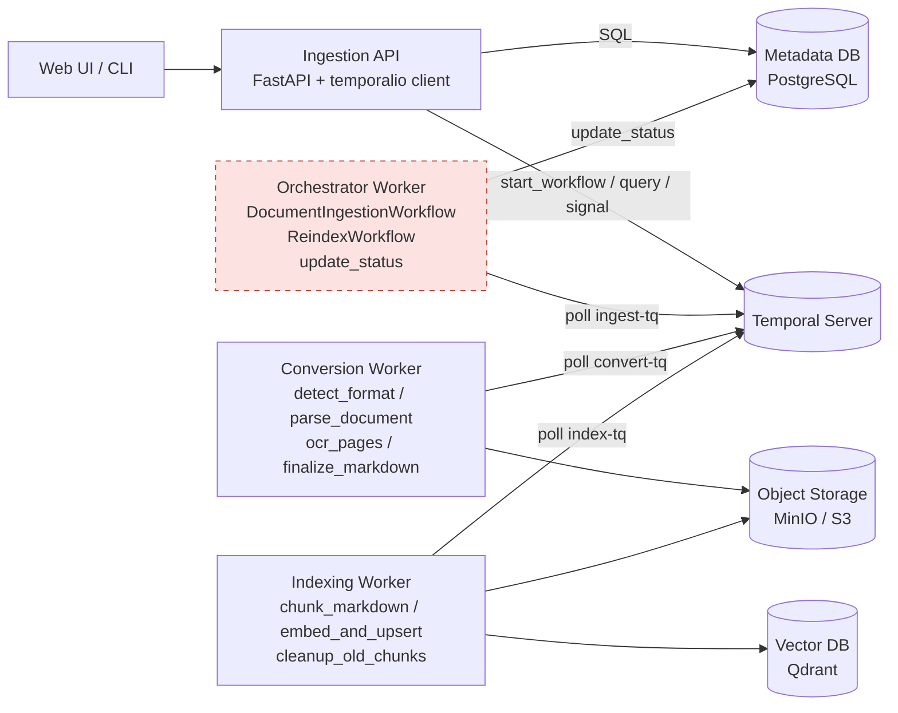
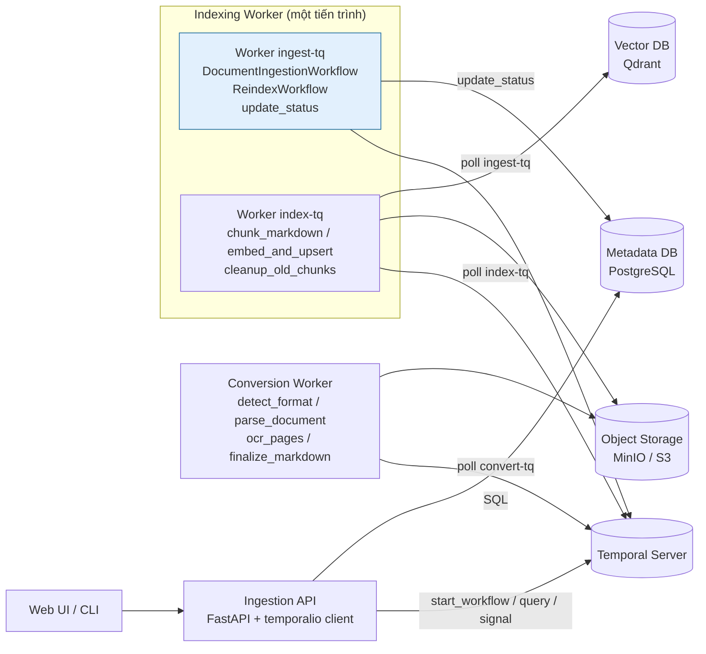
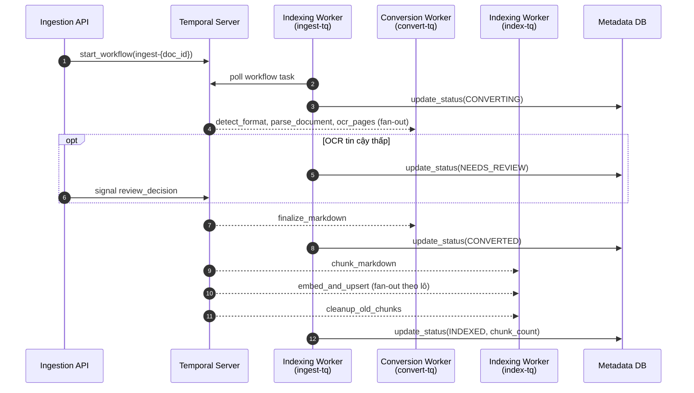

# Đề xuất: bỏ Orchestrator Worker

Đã duyệt và đã làm ngày 06/11/2026. Kiến trúc hiện tại xem ở [c4-model.md](c4-model.md). Code nằm ở `src/ingest/workers/index.py`.

Trước đó nhóm có thử một bản chạy workflow trên AWS Lambda (Temporal Serverless Workers). Bản đó đã gỡ khỏi repo vì người phụ trách thấy chưa cần worker điều phối riêng và muốn chạy toàn bộ trên máy.

Đề xuất bỏ container Orchestrator Worker và chuyển hai workflow cùng activity `update_status` sang tiến trình Indexing Worker. Hàng đợi job vẫn là task queue của Temporal, nên không cần thêm Redis hay queue tự viết. Hệ thống còn hai loại worker là Conversion và Indexing.

## Trước: ba loại worker

## Sau: hai loại worker, workflow chạy trong Indexing Worker

## Luồng một tài liệu sau khi đổi

Tám bước của `DocumentIngestionWorkflow` giữ nguyên, chỉ có code workflow chạy ở chỗ khác.

## Thay đổi so với bản cũ

| Phần | Bản cũ | Đề xuất |
|---|---|---|
| Loại worker | Orchestrator, Conversion, Indexing | Conversion, Indexing |
| Chỗ chạy workflow | Orchestrator Worker | Indexing Worker, `Worker` riêng cho `ingest-tq` |
| Task queue | `ingest-tq`, `convert-tq`, `index-tq` | Giữ nguyên ba queue |
| Indexing Worker nối tới | Storage, Qdrant, embedding API | Thêm Metadata DB |
| Mục L3 | Có 3.2 Orchestrator Worker | Bỏ 3.2, gộp vào mục Indexing Worker |
| Activity tầng indexing | 3 activity | Giữ 3 activity |

Giữ riêng `ingest-tq` để sau này nếu cần tách workflow ra worker khác thì chỉ đổi chỗ đăng ký worker, không phải sửa code workflow.

## Đánh đổi

- Scale Indexing Worker thì số poller của `ingest-tq` tăng theo. Việc này vô hại vì Temporal chỉ giao mỗi workflow task cho một poller.
- Indexing Worker chết hết thì cả convert lẫn index dừng lại, vì không còn ai chạy workflow. Lịch sử vẫn nằm trên Temporal Server, worker lên lại thì chạy tiếp từ bước dở.
- Rate limit `max_task_queue_activities_per_second` đặt trên `Worker` của `index-tq`, nên không ảnh hưởng tới workflow task trên `ingest-tq`.

Phương án thay thế là chạy `Worker` của `ingest-tq` trong Ingestion API. Sơ đồ giống hệt, chỉ khác khối màu xanh nằm trong API. Mỗi lần restart API thì workflow tạm dừng.
