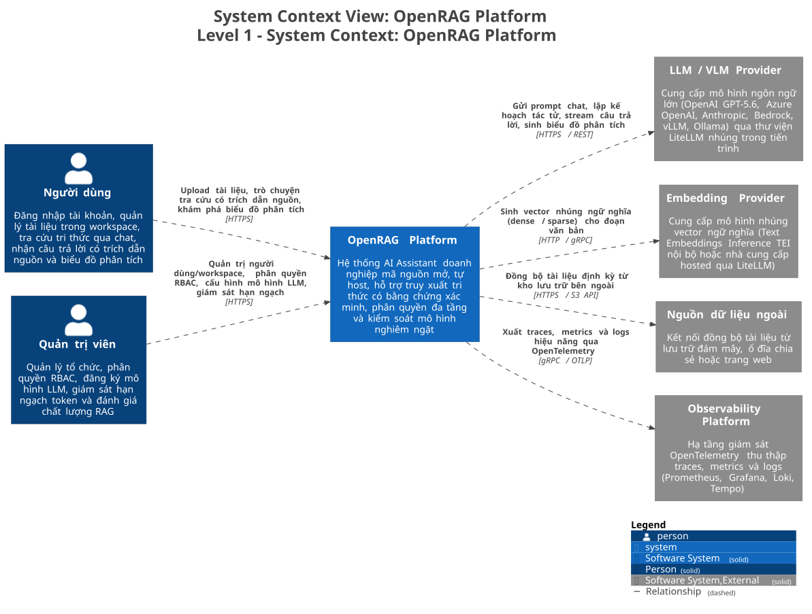
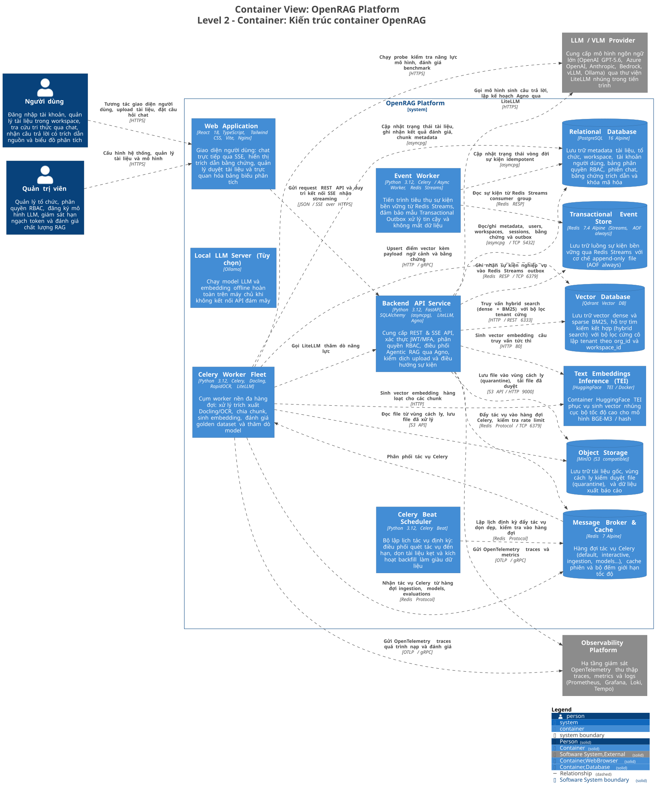
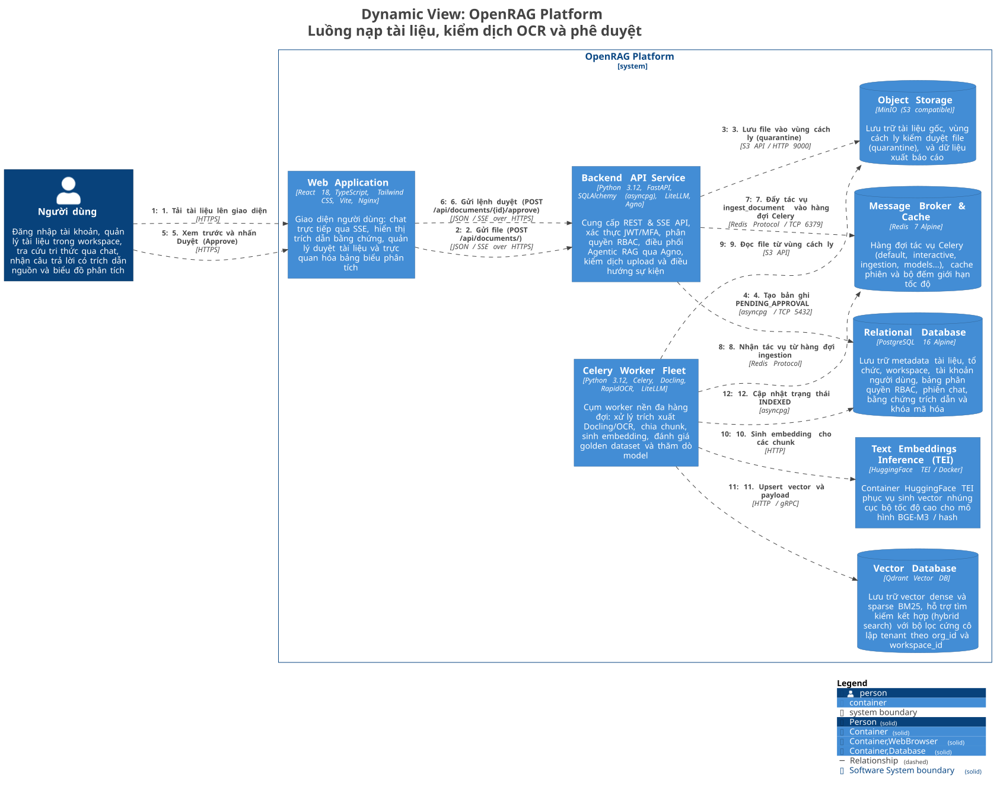
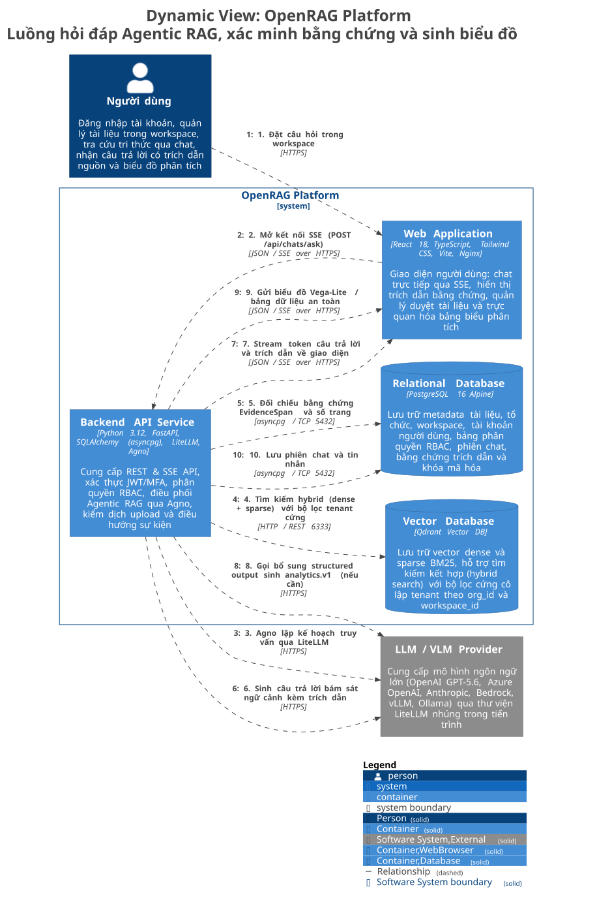
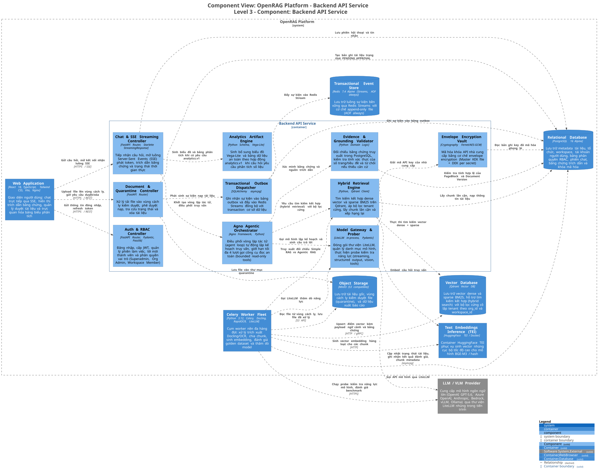
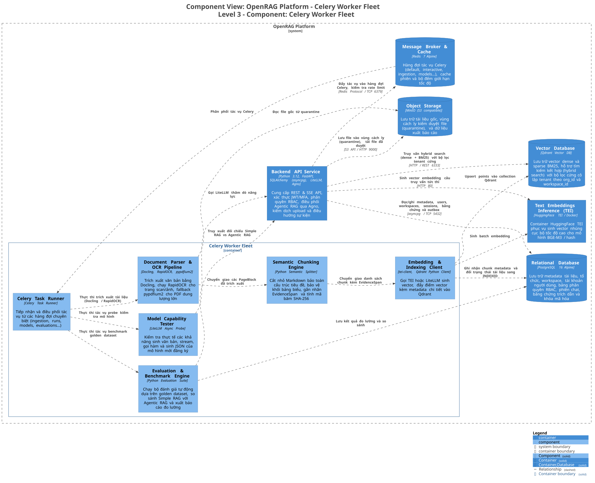

# Mô hình C4 hệ thống OpenRAG (marketcalls/openrag)

Tài liệu này ghi lại kiến trúc của repository [marketcalls/openrag](https://github.com/marketcalls/openrag). OpenRAG là nền tảng AI Assistant tự host dành cho doanh nghiệp, xây dựng trên FastAPI, React, Celery, PostgreSQL, Redis Streams, MinIO và Qdrant.

Hệ thống tập trung vào tính an toàn của dữ liệu: kiểm soát phân quyền đa tenant ở tầng lưu trữ, nạp tài liệu qua vùng cách ly và phê duyệt trước khi index, điều phối vòng lặp tìm kiếm tác tử qua Agno với các công cụ đọc có chặn biên, đối chiếu bằng chứng trích dẫn trong cơ sở dữ liệu và chỉ cho phép xuất bảng biểu hoặc biểu đồ bổ sung khi câu trả lời bằng văn bản đã vượt qua khâu kiểm tra nguồn.

> Mọi sơ đồ trong tài liệu được kết xuất từ [`architecture/workspace.dsl`](architecture/workspace.dsl) qua Structurizr DSL. Chạy script `./docs/marketcalls/architecture/render.sh` (cần Docker) để cập nhật ảnh SVG và PNG trong thư mục `architecture/diagrams/`.

---

## Level 1: System Context

Sơ đồ ngữ cảnh mô tả các tác nhân con người tương tác với OpenRAG và các hệ thống dịch vụ bên ngoài kết nối với nền tảng.

Ảnh PNG: [`L1-SystemContext.png`](architecture/diagrams/L1-SystemContext.png) · Mã nguồn PlantUML: [`L1-SystemContext.puml`](architecture/diagrams/L1-SystemContext.puml)

| Thực thể | Phân loại | Vai trò và giao thức kết nối |
|---|---|---|
| Người dùng | Tác nhân người dùng | Đăng nhập tài khoản, chuyển đổi workspace, tải tài liệu lên, tra cứu thông tin qua giao diện chat có trích dẫn nguồn và xem bảng biểu phân tích (HTTPS). |
| Quản trị viên | Tác nhân quản trị | Quản lý thành viên tổ chức, phân quyền vai trò (Superadmin, Org Admin, Workspace Member), cấu hình mô hình LLM, đặt hạn ngạch token và chạy bộ kiểm thử đánh giá chất lượng (HTTPS). |
| OpenRAG Platform | Hệ thống chính | Nền tảng AI Assistant tự host điều phối toàn bộ quy trình nạp tài liệu, hybrid retrieval, suy luận tác tử có trích dẫn và quản lý phân quyền. |
| LLM / VLM Provider | Hệ thống ngoài | Cung cấp mô hình ngôn ngữ lớn (OpenAI GPT-5.6, Azure OpenAI, Anthropic, Bedrock, Groq, vLLM, Ollama) qua thư viện LiteLLM nhúng trực tiếp trong tiến trình Python (HTTPS/REST). |
| Embedding Provider | Hệ thống ngoài | Tạo vector nhúng ngữ nghĩa (dense vector và BM25 sparse vector) qua container HuggingFace TEI nội bộ hoặc API đám mây do LiteLLM định tuyến (HTTP/gRPC). |
| Nguồn dữ liệu ngoài | Hệ thống ngoài | Kho lưu trữ S3, Google Drive, Microsoft OneDrive hoặc trang web để đồng bộ tài liệu định kỳ vào hệ thống (HTTPS/S3 API). |
| Observability Platform | Hệ thống ngoài | Hạ tầng quan sát OpenTelemetry thu thập traces, metrics và logs hiệu năng gồm OpenTelemetry Collector, Prometheus, Grafana, Loki và Tempo (OTLP qua gRPC). |

---

## Level 2: Container

Hệ thống triển khai qua Docker Compose, phân tách giữa tiến trình API hướng người dùng, cụm worker xử lý nền, cơ sở dữ liệu quan hệ, bộ nhớ đệm và các kho lưu trữ chuyên dụng.

Ảnh PNG: [`L2-Container.png`](architecture/diagrams/L2-Container.png) · Mã nguồn PlantUML: [`L2-Container.puml`](architecture/diagrams/L2-Container.puml)

| Container | Công nghệ sử dụng | Trách nhiệm và cấu hình |
|---|---|---|
| Web Application | React 18, Vite, TypeScript, Tailwind CSS, Nginx | Giao diện web hỗ trợ stream chat thời gian thực qua Server-Sent Events (SSE), hiển thị badge trích dẫn nhấp mở tài liệu gốc, quản lý danh sách tài liệu cách ly và trực quan hóa biểu đồ Vega-Lite (cổng 5173 hoặc 80 qua Nginx). |
| Backend API Service | Python 3.12, FastAPI, Uvicorn, SQLAlchemy (asyncpg), LiteLLM, Agno | Cung cấp REST API và endpoint SSE, xử lý đăng nhập JWT, kiểm tra quyền RBAC, tiếp nhận tài liệu vào vùng cách ly, chạy vòng lặp tác tử Agno và ghi nhận sự kiện transactional outbox (cổng 8000). |
| Celery Worker Fleet | Python 3.12, Celery, Docling, RapidOCR, LiteLLM | Cụm worker thực thi các tác vụ nặng: parse file bằng Docling, OCR trang scan bằng RapidOCR, chia chunk, sinh embedding, chạy probe kiểm tra model và đánh giá golden dataset. Chạy nhiều container tương ứng các hàng đợi riêng (`ingestion`, `runs`, `models`, `evaluations`, `summaries`, `enrichment`). |
| Celery Beat Scheduler | Python 3.12, Celery Beat | Bộ lập lịch định kỳ: quét tài liệu bị kẹt quá thời gian cho phép (`OPENRAG_STALE_INGEST_RECOVERY_SECONDS`), kích hoạt job kiểm tra probe model và tác vụ đánh giá định kỳ. |
| Event Worker | Python 3.12, Celery / Async Worker, Redis Streams | Tiến trình đọc sự kiện từ Redis Streams consumer group theo mô hình Transactional Outbox, đảm bảo chuyển tiếp trạng thái vòng đời tài liệu và lệnh thực thi một cách tin cậy. |
| Relational Database | PostgreSQL 16 Alpine | Lưu trữ dữ liệu quan hệ gồm người dùng, tổ chức, workspace, tài liệu, chunk metadata, phiên chat, tin nhắn, bảng outbox và bản ghi khóa API đã mã hóa phong bì (cổng 5432). |
| Message Broker & Cache | Redis 7 Alpine | Làm message broker trung chuyển các hàng đợi Celery, lưu trữ cache dữ liệu tạm và theo dõi bộ đếm giới hạn tốc độ truy cập API (cổng 6379). |
| Transactional Event Store | Redis 7.4 Alpine (Streams, AOF always) | Lưu trữ các stream sự kiện bền vững (`openrag:*`) với chế độ ghi đĩa liên tục (`appendfsync always`) và xác thực mật khẩu riêng biệt cho luồng outbox. |
| Object Storage | MinIO RELEASE.2024 (S3 API) | Lưu trữ file nhị phân gốc, lưu vùng cách ly kiểm duyệt trước khi index (`openrag-documents` bucket) và xuất dữ liệu báo cáo (cổng 9000). |
| Vector Database | Qdrant v1.11+ | Lưu trữ điểm vector nhúng dense và vector thưa BM25. Mọi truy vấn đều bắt buộc kèm bộ lọc tenant (`organization_id`, `workspace_id`) ngay trong payload index (cổng 6333). |
| Text Embeddings Inference (TEI) | HuggingFace TEI Docker | Dịch vụ sinh vector nhúng cục bộ tối ưu cho mô hình ngôn ngữ BGE-M3, phục vụ cả nạp tài liệu hàng loạt lẫn mã hóa câu hỏi truy vấn tức thì (cổng 80). |
| Local LLM Server (Tùy chọn) | Ollama | Cung cấp mô hình ngôn ngữ và vector nhúng offline cho môi trường on-premises hoàn toàn cô lập mạng ngoài (cổng 11434). |

---

## Luồng xử lý chính

### 1. Luồng nạp tài liệu, OCR và phê duyệt (Document Ingestion Flow)

OpenRAG áp dụng quy trình kiểm duyệt hai pha: tài liệu tải lên được đưa vào vùng cách ly và phải qua bước phê duyệt trước khi kích hoạt worker lập chỉ mục vector.

Ảnh PNG: [`L2-Flow-Ingestion.png`](architecture/diagrams/L2-Flow-Ingestion.png) · Mã nguồn PlantUML: [`L2-Flow-Ingestion.puml`](architecture/diagrams/L2-Flow-Ingestion.puml)

Các bước xử lý cụ thể:

1. Người dùng gửi file qua giao diện Web (`POST /api/documents/`).
2. API Service kiểm tra định dạng MIME, xác thực kích thước và ghi file vào vùng cách ly trên MinIO (`quarantine/` prefix).
3. API Service ghi bản ghi tài liệu vào PostgreSQL với trạng thái `PENDING_APPROVAL` kèm thông tin người tải và workspace sở hữu.
4. Quản trị viên hoặc người có thẩm quyền kiểm tra tài liệu trong danh sách chờ và bấm phê duyệt (`POST /api/documents/{id}/approve`).
5. API Service chuyển trạng thái sang `QUEUED`, đồng thời đẩy task `documents.ingest_document` vào hàng đợi `ingestion` trên Redis Broker.
6. Celery Ingestion Worker nhận task, chuyển trạng thái sang `PROCESSING` và kéo file từ MinIO về bộ nhớ tạm cục bộ.
7. Worker chạy chuỗi trích xuất: Docling bóc tách bố cục (đoạn văn, tiêu đề, bảng biểu), tự động phát hiện vùng ảnh bitmap trên từng trang để gọi RapidOCR, fallback qua `pypdfium2` nếu gặp file PDF dung lượng lớn.
8. Worker tạo danh sách `PageBlock` và cắt thành các `Chunk` giữ nguyên cấu trúc tiêu đề, bảo toàn bảng Markdown, gắn nhãn `EvidenceSpan` (tọa độ bbox, số trang, section path) và tính mã băm SHA-256.
9. Worker gửi các khối văn bản qua dịch vụ TEI (hoặc LiteLLM embedding profile) để tạo vector dense và sparse.
10. Worker upsert các điểm vector vào Qdrant kèm payload chứa `organization_id`, `workspace_id`, `document_id`, `version` và nội dung đoạn trích.
11. Worker ghi nhận metadata các chunk vào PostgreSQL và cập nhật trạng thái tài liệu sang `INDEXED`. Nếu lỗi không thể khôi phục, trạng thái chuyển sang `FAILED` kèm thông điệp lỗi chi tiết.

### 2. Luồng hỏi đáp Agentic RAG và sinh bảng biểu (Agentic Chat & Analytical Flow)

OpenRAG không đưa thẳng câu hỏi vào LLM một lần duy nhất. Hệ thống sử dụng framework Agno để điều phối một kế hoạch truy vấn có chặn biên, sau đó bắt buộc đối chiếu bằng chứng trước khi xuất kết quả hoặc sinh biểu đồ.

Ảnh PNG: [`L2-Flow-Chat.png`](architecture/diagrams/L2-Flow-Chat.png) · Mã nguồn PlantUML: [`L2-Flow-Chat.puml`](architecture/diagrams/L2-Flow-Chat.puml)

Chi tiết các bước thực hiện:

1. Người dùng nhập câu hỏi trên giao diện chat trong workspace cụ thể.
2. Web client gửi request `POST /api/chats/ask` và giữ kết nối Server-Sent Events (SSE).
3. API Service khởi tạo phiên hội thoại, tải lịch sử tin nhắn gần nhất và khởi động Agno Planner.
4. Agno Planner phân tích câu hỏi và có thể gọi tối đa 4 công cụ đọc an toàn (read-only tools): tìm kiếm hybrid toàn cục, lọc theo tên file/loại file/section, tìm kiếm trong một tài liệu cụ thể, hoặc lấy các chunk lân cận.
5. Mỗi lệnh tìm kiếm được thực thi trên Qdrant với bộ lọc cứng theo `organization_id` và `workspace_id` của phiên người dùng hiện tại, ngăn ngừa rò rỉ dữ liệu giữa các tenant.
6. Module Evidence Grounding lấy danh sách các đoạn trích thu được, đối chiếu ngược lại PostgreSQL để kiểm tra phiên bản tài liệu hiện hành (`current_version`) và tính hợp lệ của tọa độ trang `EvidenceSpan`. Nếu không đủ căn cứ chứng minh, hệ thống trả về thông báo từ chối lịch sự thay vì đoán mò.
7. LiteLLM gửi prompt kèm các đoạn ngữ cảnh đã xác minh tới mô hình LLM chính (ví dụ GPT-5.6), stream từng token câu trả lời về giao diện người dùng qua SSE.
8. Ngay trước khi phát nội dung văn bản, API phát sự kiện chứa danh sách trích dẫn nguồn (tên file, số trang, đoạn trích) để giao diện hiển thị badge tham chiếu.
9. Nếu người dùng yêu cầu rõ ràng về việc lập bảng, so sánh chỉ số hoặc vẽ biểu đồ, hệ thống thực hiện thêm một lệnh gọi bổ sung (supplemental call) yêu cầu mô hình sinh cấu trúc `analytics.v1` (Vega-Lite chart hoặc bảng HTML đã khử khuẩn). Bước này chỉ chạy sau khi câu trả lời văn bản đã được xác nhận bằng chứng đầy đủ.
10. API phát sự kiện artifact về giao diện và lưu trữ toàn bộ phiên hỏi đáp vào PostgreSQL.

---

## Level 3: Component

### 3.1 Backend API Service (FastAPI)

Backend API đóng vai trò cổng giao tiếp trung tâm, tiếp nhận các kết nối từ client, thực thi phân quyền và điều phối luồng truy vấn tri thức.

Ảnh PNG: [`L3-BackendAPI.png`](architecture/diagrams/L3-BackendAPI.png) · Mã nguồn PlantUML: [`L3-BackendAPI.puml`](architecture/diagrams/L3-BackendAPI.puml)

| Thành phần | Vị trí mã nguồn | Trách nhiệm chính |
|---|---|---|
| Auth & RBAC Controller | `openrag/api/routes/auth.py`, `roles.py`, `users.py` | Quản lý đăng ký, đăng nhập, phát hành JWT access token trong bộ nhớ và refresh token qua HttpOnly cookie, kiểm tra ma trận phân quyền 3 cấp (Superadmin, Org Admin, Workspace Member). |
| Document & Quarantine Controller | `openrag/api/routes/documents.py` | Tiếp nhận upload file vào vùng cách ly MinIO, kiểm tra magic bytes, kích hoạt lệnh phê duyệt nạp, tra cứu tiến độ parse/index và xử lý xóa tài liệu đa tầng. |
| Chat & SSE Streaming Controller | `openrag/api/routes/chats.py`, `memories.py` | Điểm tiếp nhận câu hỏi chat, quản lý context bộ nhớ hội thoại, mở luồng `StreamingResponse` phát token, citation chips và trạng thái tác tử qua SSE. |
| Agno Agentic Orchestrator | `openrag/modules/orchestration/agent_loop.py`, `agno_planner.py` | Quản lý vòng lặp tác tử Agno: lập kế hoạch tìm kiếm, giới hạn số lượt gọi công cụ đọc tối đa là 4, tổng hợp dữ liệu quan sát và chuyển giao cho khâu sinh lời đáp. |
| Hybrid Retrieval Engine | `openrag/modules/retrieval/` | Kết nối Qdrant thực thi tìm kiếm kết hợp dense vector và sparse BM25, áp dụng bộ lọc tenant cứng, lấy các chunk văn bản liền trước và liền sau để mở rộng ngữ cảnh. |
| Evidence & Grounding Validator | `openrag/modules/grounding/`, `answer_validation.py` | Kiểm tra độc lập các đoạn trích dẫn đối chiếu với cơ sở dữ liệu PostgreSQL. Nếu không tìm thấy bằng chứng khớp với số trang và phiên bản tài liệu hợp lệ, hệ thống từ chối trả lời. |
| Analytics Artifact Engine | `openrag/modules/artifacts/` | Tạo biểu đồ Vega-Lite và bảng dữ liệu an toàn theo hợp đồng `analytics.v1`. Dữ liệu trực quan hóa mang tính bổ trợ, không được phép thay đổi nội dung văn bản trả lời gốc. |
| Model Gateway & Prober | `openrag/modules/models/`, `model_gateway.py` | Đóng gói thư viện LiteLLM, quản lý danh mục mô hình, thực hiện các probe kiểm tra tính năng mô hình trước khi cho phép sử dụng trong workspace. |
| Envelope Encryption Vault | `openrag/modules/secrets/` | Quản lý khóa bí mật của các nhà cung cấp mô hình bằng cơ chế mã hóa phong bì: sử dụng khóa chính (KEK) lưu trong file bảo mật để mã hóa các khóa dữ liệu (DEK) lưu trong PostgreSQL. |
| Transactional Outbox Dispatcher | `openrag/modules/events/`, `event_runtime.py` | Ghi nhận sự kiện nghiệp vụ vào bảng outbox trong cùng transaction của cơ sở dữ liệu, sau đó chuyển tiếp vào Redis Streams để các tiến trình nền xử lý. |

### 3.2 Celery Worker Fleet

Cụm worker chạy nền sử dụng chung codebase với API Service nhưng được tách thành các container độc lập theo từng loại hàng đợi để điều tiết tài nguyên máy chủ.

Ảnh PNG: [`L3-WorkerFleet.png`](architecture/diagrams/L3-WorkerFleet.png) · Mã nguồn PlantUML: [`L3-WorkerFleet.puml`](architecture/diagrams/L3-WorkerFleet.puml)

| Thành phần | Vị trí mã nguồn | Trách nhiệm chính |
|---|---|---|
| Celery Task Runner | `openrag/worker/celery_app.py`, `tasks.py` | Khởi tạo ứng dụng Celery với cấu hình `task_acks_late=True`, `worker_prefetch_multiplier=1`, định tuyến tác vụ vào đúng hàng đợi (`ingestion`, `models`, `evaluations`, `runs`, `events`). |
| Document Parser & OCR Pipeline | `openrag/modules/documents/parser.py` | Trích xuất tài liệu nhiều trang bằng Docling, tính toán tỷ lệ vùng bitmap để kích hoạt RapidOCR cục bộ theo từng trang, bóc tách cấu trúc bảng và fallback qua `pypdfium2` khi file quá lớn. |
| Semantic Chunking Engine | `openrag/modules/documents/chunking.py` | Chia nhỏ văn bản theo phân cấp tiêu đề Markdown, giữ nguyên vẹn các bảng tính, gắn nhãn vị trí `EvidenceSpan` và tính toán content hash SHA-256 đảm bảo tính idempotent. |
| Embedding & Indexing Client | `openrag/modules/embeddings/`, `tasks.py` | Gửi các khối chunk qua dịch vụ HuggingFace TEI hoặc LiteLLM để lấy vector nhúng, sau đó upsert các điểm vector kèm metadata đầy đủ vào Qdrant collection. |
| Model Capability Tester | `openrag/worker/model_probe_runtime.py` | Chạy tác vụ kiểm thử tự động trên mô hình mới thêm vào: kiểm tra khả năng stream token, sinh JSON có cấu trúc, gọi tool function và đọc hiểu hình ảnh. |
| Evaluation & Benchmark Engine | `openrag/modules/evaluations/`, `evaluation_runtime.py` | Thực thi bộ benchmark 54 câu hỏi theo kịch bản chuẩn, đối chiếu kết quả giữa Simple RAG và Agentic RAG, đo lường độ chính xác trích dẫn và xuất file so sánh JSON. |

---

## Các quyết định kỹ thuật cốt lõi

1. **Transactional Outbox trên nền Redis Streams và AOF**: Nhằm tránh tình trạng phân rã dữ liệu giữa cơ sở dữ liệu PostgreSQL và hàng đợi tác vụ khi có sự cố mạng hoặc sập nguồn, các sự kiện vòng đời tài liệu được ghi trước vào bảng outbox trong cùng transaction của cơ sở dữ liệu. Tiến trình dispatcher sau đó đọc outbox và đẩy vào Redis Streams được cấu hình `appendfsync always`, giúp việc xử lý sự kiện đạt độ bền vững cao và không bị mất mát tác vụ.
2. **Kiểm dịch nạp tài liệu hai pha (Quarantine & Approval)**: File tải lên không được nạp thẳng vào vector database. Tài liệu được lưu tạm tại thư mục cách ly trên MinIO để quản trị viên hoặc người dùng có quyền kiểm tra, xem trước chất lượng OCR và xác nhận nội dung. Cơ chế này ngăn chặn việc đưa các tài liệu rác, tài liệu độc hại hoặc dữ liệu chưa qua thẩm định vào kho tri thức chung của tổ chức.
3. **Vòng lặp tác tử Agno có chặn biên (Bounded Agentic Retrieval)**: Khác với các hệ thống RAG tự do để tác tử gọi công cụ không giới hạn dẫn đến bùng nổ chi phí và độ trễ, OpenRAG giới hạn cứng tối đa 4 lượt gọi công cụ đọc an toàn (read-only tools). Các công cụ này chỉ có quyền tìm kiếm theo phạm vi tenant đã được khóa chặt, lấy chunk lân cận hoặc tra cứu metadata, hoàn toàn không có quyền ghi dữ liệu.
4. **Xác minh bằng chứng độc lập trước khi trả lời (Evidence Grounding)**: Các đoạn văn bản tìm được qua vector search không được đưa ngay vào câu trả lời cuối cùng. Hệ thống đối chiếu các `EvidenceSpan` ngược lại cơ sở dữ liệu để xác minh số trang, đường dẫn đề mục và phiên bản tài liệu. Nếu không tìm thấy bằng chứng xác thực hợp lệ, hệ thống áp dụng cơ chế từ chối (fail-closed) thay vì để mô hình suy diễn không có căn cứ.
5. **Hợp đồng phân tích dữ liệu tách biệt (analytics.v1)**: Khi người dùng yêu cầu vẽ biểu đồ hoặc tạo bảng tính, hệ thống không để LLM tự do sinh mã HTML tùy tiện. OpenRAG trước hết sinh câu trả lời bằng văn bản Markdown đã được xác thực nguồn, sau đó thực hiện một lệnh gọi bổ sung duy nhất để sinh cấu trúc dữ liệu theo schema `analytics.v1`. Bản biểu đồ Vega-Lite hoặc bảng dữ liệu này được hiển thị bổ trợ trong giao diện và không bao giờ được phép thay thế câu trả lời gốc.
6. **Bảo mật khóa API bằng mã hóa phong bì (Envelope Encryption)**: Khóa API của các nhà cung cấp mô hình (OpenAI, Anthropic...) là dữ liệu nhạy cảm chỉ ghi một lần từ giao diện. Hệ thống tạo khóa dữ liệu riêng (DEK) cho từng bản ghi và mã hóa lại bằng khóa chính (KEK) lưu trong file bí mật trên máy chủ (`/data/openrag_kek`). Khóa API không bao giờ hiển thị lại trên giao diện mà chỉ xuất hiện dưới dạng fingerprint rút gọn.
7. **Kiểm tra năng lực mô hình tự động (LiteLLM Capability Probing)**: Khi quản trị viên đăng ký một mô hình mới, hệ thống kích hoạt worker chạy ngầm một loạt bài kiểm tra probe để đánh giá thực tế khả năng stream, sinh output có cấu trúc, gọi hàm và xử lý hình ảnh. Chỉ khi mô hình vượt qua các bài kiểm tra này thì các tính năng tương ứng trong workspace mới được kích hoạt.
